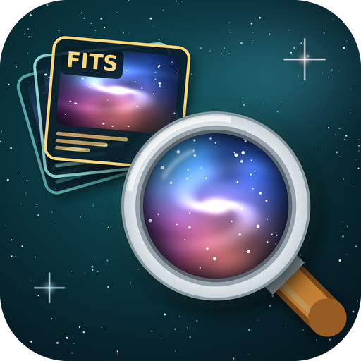

<p align="center"></p>

# FITS Archive Search

*Search and download telescope FITS images by object name from MAST, IRSA, Chandra and ESO* — original Italian name: «Ricerca archivi FITS»

Type an object name (or coordinates) and the program asks the main public archives for images of that field: MAST (JWST, Hubble, GALEX, Swift UVOT, Pan-STARRS, Spitzer), IRSA (Euclid Q1 mosaics, Spitzer, WISE, 2MASS…), the Chandra archive and ESO (VLT, VISTA, VST reduced products). Results are listed with size and band and downloaded into a tidy folder per object. Only public data: no account needed.

## Features

* Name resolution with Sesame, NED, Wikipedia/Wikidata and SIMBAD; offline NGC/IC/Messier names (OpenNGC)
* A slow archive never blocks the search (3-minute limit)
* Diagnostics that query every archive from your network (`diagnostica.txt`)
* Can be launched by Celestial Atlas, Celestial Atom and Milky Way 3D

> **Language note.** The interface is in **Italian** (large, adjustable text); plots, PDF/PNG cards and scientific output are in **English**. Code comments are in Italian. The original Italian guide is [`LEGGIMI.txt`](LEGGIMI.txt).

**Version:** 1.11 (2026-11-09). **Status:** Stable: built and used daily.

## Quick start

Requirements: Python 3.10+ (tested with Python 3.14 on Ubuntu) with `tkinter` (Ubuntu: `sudo apt install python3-tk`).

```bash
git clone https://github.com/EDOKILLER/fits-archive-search.git
cd fits-archive-search
python3 -m pip install -r requirements.txt

python3 ricerca_archivi.py --autotest
python3 ricerca_archivi.py --diagnostica
python3 ricerca_archivi.py        # opens the window
```

### Standalone executable

`bash crea_eseguibile_ubuntu.sh` builds a single-file executable with PyInstaller in a temporary virtual environment, runs the self-test, and adds the program with its icon to the application menu and the desktop (first time on GNOME: right-click → *Allow launching*). On Windows 11 install Python from python.org (tick *Add python.exe to PATH*) and double-click `crea_eseguibile_windows.bat`.

The build scripts were written for the author's machine: check the paths at the top before running them.

## Data sources and acknowledgements

Data are downloaded at run time from public services. If you publish results, please follow their acknowledgement policies:

* [Mikulski Archive for Space Telescopes (STScI): Hubble, JWST, Kepler, TESS, GALEX, Pan-STARRS](https://archive.stsci.edu/)
* [NASA/IPAC Infrared Science Archive: 2MASS, WISE, Spitzer, Euclid, Planck](https://irsa.ipac.caltech.edu/)
* [Chandra Data Archive](https://cxc.harvard.edu/cda/)
* [ESO Science Archive](https://archive.eso.org/)
* [NASA/IPAC Extragalactic Database](https://ned.ipac.caltech.edu/)
* [SIMBAD database, CDS, Strasbourg](https://simbad.cds.unistra.fr/)
* [Wikidata / Wikipedia](https://www.wikidata.org/)

The file `openngc_compatto.csv` is a compact copy of [OpenNGC](https://github.com/mattiaverga/OpenNGC) by Mattia Verga, licensed under CC BY-SA 4.0 (see `OpenNGC_licenza_CC-BY-SA-4.0.txt`); it keeps that licence, not the BSD licence of the code.

This project is independent and not endorsed by any of these institutions.

## License

Code: [BSD 3-Clause](LICENSE) © 2026 Edoardo Battistel. You can use, modify and redistribute it, also commercially, as long as you keep the copyright notice; the author's name may not be used to promote derived works without permission. If you use it in research, see [`CITATION.cff`](CITATION.cff).

---
Part of a series of astronomy programs by Edoardo Battistel — see also [X-rays from Black Holes](https://github.com/EDOKILLER/x-rays-from-black-holes) and the other repositories on [this profile](https://github.com/EDOKILLER?tab=repositories).
